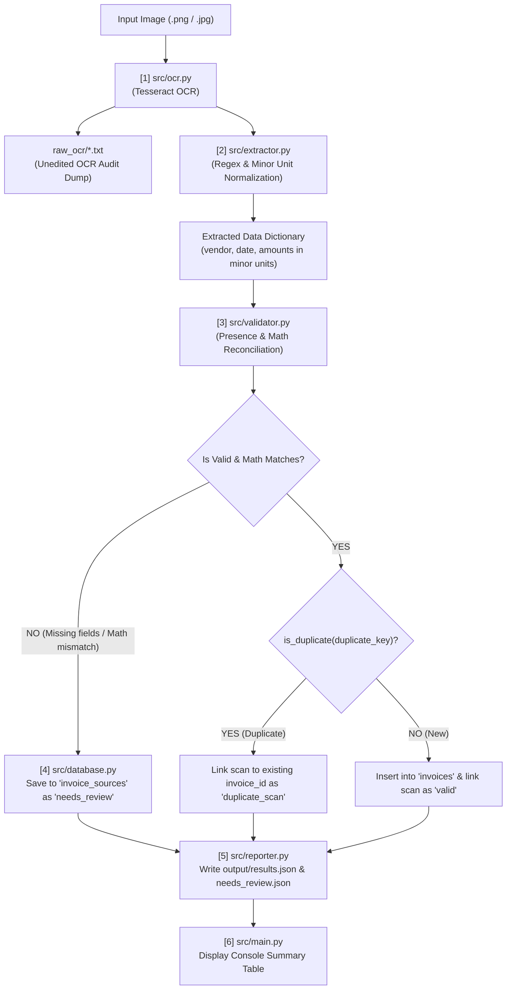

# Invoice Digitization & Duplicate Detection Pipeline

A production-ready, lightweight, and auditable Python CLI application for digitizing, extracting, validating, and persisting invoice data from local image scans using **Tesseract OCR**, **Regular Expressions**, and **SQLite**.

Built with a **zero-ORM, class-free, pure-function architecture** designed for high reliability, strict financial precision, and beginner-friendly explainability.

---

## 1. Architectural Highlights

- **Zero ORM (Pure Standard Library `sqlite3`):** Eliminates complex abstractions and heavy dependencies. Uses raw, parameterized SQL queries (`?`) to prevent SQL injection and enforce database-level relational constraints.
- **Pure Functions Only (Zero Classes):** Every module (`ocr.py`, `extractor.py`, `validator.py`, `database.py`, `reporter.py`, `main.py`) is written as simple, composable, testable functions returning standard Python dictionaries.
- **Smart Duplicate Invoice Detection:** Uses a dedicated, normalized **`duplicate_key`** column (`<vendor_lowercase>_<invoice_uppercase>`) instead of brittle file hashing. Even if the filename, resolution, or casing differs (e.g., `"Acme Supplies"` vs `"ACME SUPPLIES "`), duplicate invoices are accurately identified.
- **Two-Table Relational Schema ($1:N$):** Separates unique master invoices (`invoices`) from physical image scans (`invoice_sources`). Multiple scans of the same invoice link back to the single master record without inflating financial balances.
- **Exact Financial Mathematics:** Rejects floating-point arithmetic (avoiding binary rounding bugs like `0.1 + 0.2 = 0.30000000000000004`). All monetary values are converted to exact integer minor units (cents/paise) using Python's `Decimal` module.
- **Strict Business Validation:** Enforces mathematical reconciliation ($\text{Subtotal} + \text{Tax} == \text{Total}$) and presence checks. Corrupted or missing values are routed to `needs_review`—**never silently guessed**.
- **Automated JSON Audit Reports:** Generates `output/results.json` (complete ingestion log) and `output/needs_review.json` (flagged invoices requiring human verification with specific diagnostic reasons).
- **Fast, Deterministic Test Suite:** 5 isolated unit and integration tests using fixed OCR text fixtures, running in `<0.3s` without requiring an external Tesseract binary.

---

## 2. Pipeline Architecture & Data Flow



---

## 3. Technology Stack

| Component | Technology | Rationale |
|---|---|---|
| **Language** | Python 3.10+ | Clean standard library, typed annotations |
| **OCR Engine** | Tesseract OCR (v5.x) | Local, open-source OCR (no paid external APIs) |
| **Image Processing** | Pillow (`PIL`) | Robust image reading, format validation |
| **Database** | SQLite3 (`sqlite3`) | Standard library, zero setup, ACID compliant |
| **Money Handling** | Python `Decimal` | Exact minor currency conversion (no float bugs) |
| **Testing** | Pytest | Deterministic, fixture-based automated testing |
| **Architecture** | Pure Functions | Beginner-friendly, predictable, no class overhead |

---

## 4. Database Schema Design

The SQLite database enforces relational integrity, foreign key checks (`PRAGMA foreign_keys = ON;`), and uniqueness constraints:

```sql
-- 1. Master Invoices Table (One row per unique logical invoice)
CREATE TABLE IF NOT EXISTS invoices (
    id INTEGER PRIMARY KEY AUTOINCREMENT,
    vendor TEXT NOT NULL,
    invoice_number TEXT NOT NULL,
    duplicate_key TEXT NOT NULL UNIQUE,
    invoice_date TEXT NOT NULL,
    currency TEXT NOT NULL,
    subtotal REAL NOT NULL,
    tax REAL NOT NULL,
    total REAL NOT NULL,
    subtotal_minor INTEGER,
    tax_minor INTEGER,
    total_minor INTEGER,
    created_at TIMESTAMP DEFAULT CURRENT_TIMESTAMP
);

-- 2. Source Image Scans (Audit trail preserving every physical file)
CREATE TABLE IF NOT EXISTS invoice_sources (
    id INTEGER PRIMARY KEY AUTOINCREMENT,
    invoice_id INTEGER NULL,
    filename TEXT NOT NULL,
    filepath TEXT,
    raw_ocr_text TEXT,
    processing_status TEXT NOT NULL,
    review_reason TEXT,
    processed_at TIMESTAMP DEFAULT CURRENT_TIMESTAMP,
    FOREIGN KEY (invoice_id) REFERENCES invoices(id) ON DELETE SET NULL
);

-- Fast O(1) Unique Index on normalized duplicate key
CREATE UNIQUE INDEX IF NOT EXISTS uq_invoices_duplicate_key
ON invoices(duplicate_key);
```

### Duplicate Key Generation Rule
```python
duplicate_key = f"{vendor.strip().lower()}_{invoice_number.strip().upper()}"
```
* **Example:**
  - Vendor: `"Acme Office Supplies "` $\rightarrow$ `"acme office supplies"`
  - Invoice Number: `"tnm-101"` $\rightarrow$ `"TNM-101"`
  - Key: **`"acme office supplies_TNM-101"`**

---

## 5. Project Directory Structure

```text
Invoice_Digitization/
├── input/                      # Input invoice images (.png)
│   ├── invoice-101.png         # Valid standard invoice
│   ├── invoice-101-copy.png    # Duplicate scan of invoice-101
│   ├── invoice-102.png         # Second valid invoice (different vendor)
│   └── invoice-103-review.png  # Ambiguous date & math mismatch fixture
│
├── raw_ocr/                    # Unedited OCR text dumps for auditability
│   ├── invoice-101.txt
│   ├── invoice-101-copy.txt
│   ├── invoice-102.txt
│   └── invoice-103-review.txt
│
├── output/                     # Generated audit reports
│   ├── results.json            # Full audit log of all processed scans
│   └── needs_review.json       # Filtered queue of invoices needing manual review
│
├── src/                        # Pure function application source code
│   ├── __init__.py             # Package marker
│   ├── ocr.py                  # Local OCR engine & Windows auto-discovery
│   ├── extractor.py            # Regex extraction & minor unit converters
│   ├── validator.py            # Field presence & math reconciliation
│   ├── database.py             # SQLite DDL, duplicate_key deduplication
│   ├── reporter.py             # JSON report formatting & export
│   └── main.py                 # Single master pipeline orchestrator & CLI
│
├── tests/                      # Automated test suite
│   ├── __init__.py             # Test package marker
│   └── test_invoice.py         # 5 comprehensive pytest unit tests
│
├── requirements.txt            # Minimal pinned dependencies
├── .gitignore                  # Git exclusions (.db, __pycache__, venv)
├── README.md                   # Technical documentation
└── invoices.db                 # Auto-generated SQLite database
```

---

## 6. Installation & Setup

### Prerequisites
- Python 3.10 or newer:
  ```powershell
  python --version
  ```

### Step 1: Install Tesseract OCR (Windows)
1. Download the official installer from UB-Mannheim:
   [https://github.com/UB-Mannheim/tesseract/wiki](https://github.com/UB-Mannheim/tesseract/wiki)
2. Install to default path (`C:\Program Files\Tesseract-OCR`) or local app data.
   > **Note:** `src/ocr.py` automatically auto-discovers your local Tesseract installation without needing manual Windows environment variable configuration.

### Step 2: Install Python Dependencies
```powershell
pip install -r requirements.txt
```

---

## 7. How to Run

### Run the Pipeline
Simply execute the main file:
```powershell
python src/main.py
```
*or as a module:*
```powershell
python -m src.main
```

### Execution Console Output:
```text
Starting Invoice Digitization Pipeline...

=============================================
      INVOICE DIGITIZATION SUMMARY
=============================================
Total images processed : 4
Valid invoices stored  : 2
Duplicate scans        : 1
Needs review           : 1
Failed images          : 0
=============================================

Reports successfully generated in 'output/'.
Raw OCR text saved in 'raw_ocr/'.
SQLite database updated at 'invoices.db'.
```

---

## 8. Automated Test Suite

The test suite validates all business logic, extraction regexes, deduplication rules, and error handlers using deterministic in-memory text fixtures (no Tesseract binary required for testing).

Run all tests:
```powershell
python -m pytest -v
```

### Test Coverage Summary:
| Test Name | Verifies | Status |
|---|---|---|
| `test_valid_invoice_extraction_and_validation` | Clean extraction, correct minor currency units, math pass, database insert | **PASSED** |
| `test_duplicate_and_repeated_import` | Links duplicate scans to existing invoice ID; enforces idempotent re-runs | **PASSED** |
| `test_incomplete_or_ambiguous_invoice` | Missing date and math mismatch routed to `needs_review`; `invoices` table remains untouched | **PASSED** |
| `test_math_mismatch_fails_validation` | Subtotal + Tax $\ne$ Total generates clear, diagnostic review reason | **PASSED** |
| `test_corrupted_image_handling` | Gracefully records unreadable images without crashing the batch pipeline | **PASSED** |

---

## 9. Handling of Real-World Scenarios

### Scenario 1: A New Valid Invoice (`invoice-101.png`)
1. OCR extracts `Vendor: Acme Office Supplies`, `Invoice: TNM-101`, `Total: 1416.59`.
2. Generates `duplicate_key = "acme office supplies_TNM-101"`.
3. Checks `is_duplicate()` $\rightarrow$ returns `False`.
4. Inserts row into `invoices` (assigned `id = 1`).
5. Logs scan in `invoice_sources` with `invoice_id = 1` and `processing_status = 'valid'`.

### Scenario 2: Duplicate Invoice from Another Image (`invoice-101-copy.png`)
1. OCR extracts `Vendor: ACME OFFICE SUPPLIES`, `Invoice: TNM-101`.
2. Generates `duplicate_key = "acme office supplies_TNM-101"`.
3. Checks `is_duplicate()` $\rightarrow$ matches existing record `id = 1`.
4. **Does NOT insert a second row in `invoices`**.
5. Logs scan in `invoice_sources` with `invoice_id = 1`, `processing_status = 'duplicate_scan'`, and a descriptive reason.

### Scenario 3: Missing Fields / Corrupt Data (`invoice-103-review.png`)
1. OCR finds `Date: [not supplied]` and a financial discrepancy:
   $$\text{Subtotal } (1000.00) + \text{Tax } (180.00) = 1180.00 \ne \text{Total } (1170.00)$$
2. Validation engine rejects guessing values.
3. **No row is created in `invoices`** (accounting balances protected).
4. Logs scan in `invoice_sources` with `invoice_id = NULL` and `processing_status = 'needs_review'`.
5. Exports diagnostic details to `output/needs_review.json`.

### Scenario 4: Re-running the Program on the Same Folder
1. On run #2, the pipeline detects that the filename is already in `invoice_sources`.
2. Returns `already_processed` without re-inserting duplicate entries.
3. Database record counts remain identical (strict idempotency).

---

## 10. Sample SQLite Records

Verify database records directly from your terminal:
```powershell
python -c "import sqlite3; conn = sqlite3.connect('invoices.db'); conn.row_factory = sqlite3.Row; print('=== INVOICES ==='); [print(dict(r)) for r in conn.execute('SELECT id, vendor, invoice_number, duplicate_key, total FROM invoices')]; print('\n=== SOURCES ==='); [print(dict(r)) for r in conn.execute('SELECT id, invoice_id, filename, processing_status FROM invoice_sources')]"
```

### Table: `invoices`
```text
{'id': 1, 'vendor': 'ACME OFFICE SUPPLIES', 'invoice_number': 'TNM-101', 'duplicate_key': 'acme office supplies_TNM-101', 'total': 1416.59}
{'id': 2, 'vendor': 'Beta Print Studio', 'invoice_number': 'TNM-102', 'duplicate_key': 'beta print studio_TNM-102', 'total': 1770.0}
```

### Table: `invoice_sources`
```text
{'id': 1, 'invoice_id': 1, 'filename': 'invoice-101-copy.png', 'processing_status': 'valid'}
{'id': 2, 'invoice_id': 1, 'filename': 'invoice-101.png', 'processing_status': 'duplicate_scan'}
{'id': 3, 'invoice_id': 2, 'filename': 'invoice-102.png', 'processing_status': 'valid'}
{'id': 4, 'invoice_id': None, 'filename': 'invoice-103-review.png', 'processing_status': 'needs_review'}
```

---

## 11. Sample JSON Reports

### `output/needs_review.json` (Diagnostic Review Queue)
```json
[
  {
    "source_filename": "invoice-103-review.png",
    "validation_status": "needs_review",
    "review_reasons": [
      "Missing or invalid invoice date (expected YYYY-MM-DD)",
      "Math mismatch: Subtotal (1000.00) + Tax (180.00) = 1180.00, but Total is 1170.00 (discrepancy of 1000 minor units)"
    ],
    "missing_or_ambiguous_fields": [
      "invoice_date"
    ],
    "extracted_values": {
      "invoice_number": "TNM-103",
      "vendor": "Gamma Paper Co",
      "invoice_date": null,
      "currency": "INR",
      "subtotal": 1000.0,
      "tax": 180.0,
      "total": 1170.0,
      "subtotal_minor": 100000,
      "tax_minor": 18000,
      "total_minor": 117000
    },
    "processed_at": "2026-11-13T20:28:36.123456"
  }
]
```

---

## 12. Author & License

- **Author:** Rahul Pandit (`pandit07.it@gmail.com`)
- **License:** MIT
